# Hearth on Plasma (extras), 559de3f

## ph-00-plain-kde-plasma

## ph-70-glass-dark-desktop

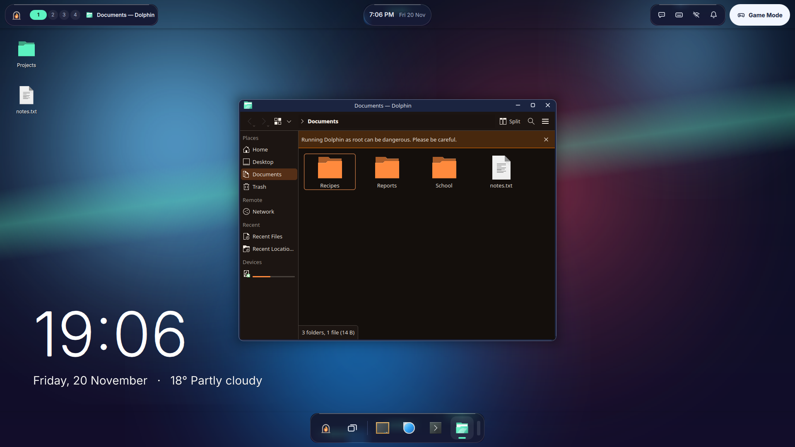

## ph-71-glass-light-desktop

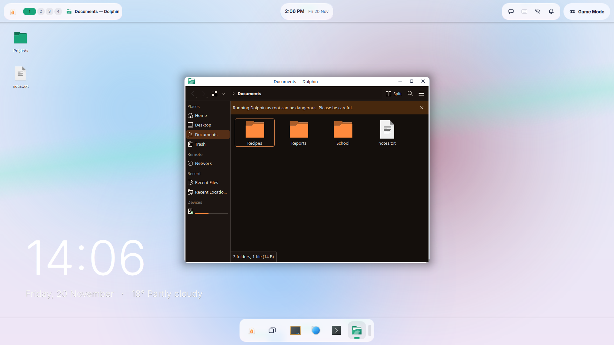

## ph-72-glass-dark-stripes

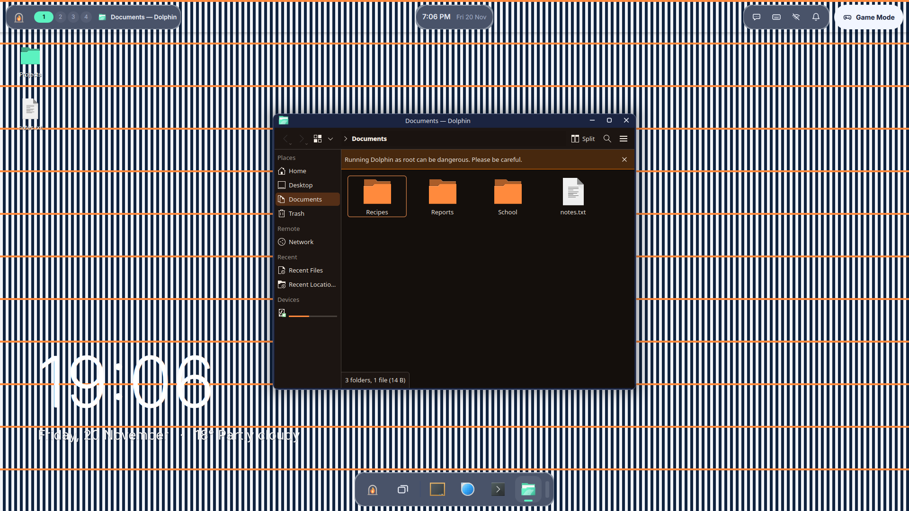

## ph-72b-glass-blur-close

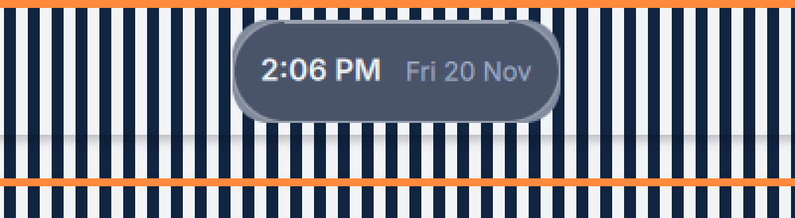

## ph-73-alt-tab-held

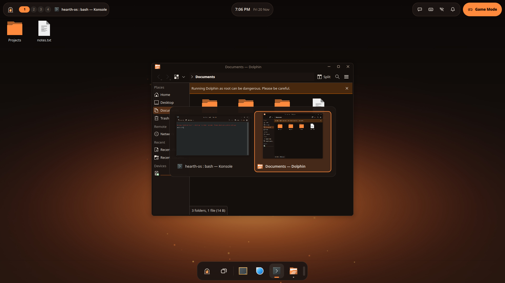

## ph-73a-before-alt-tab

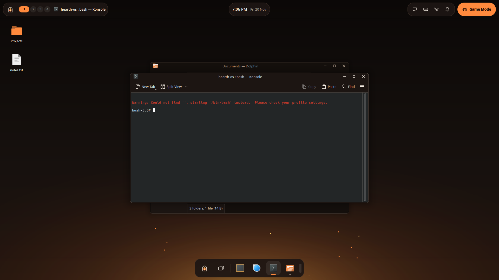

## ph-74-tray-and-now-playing

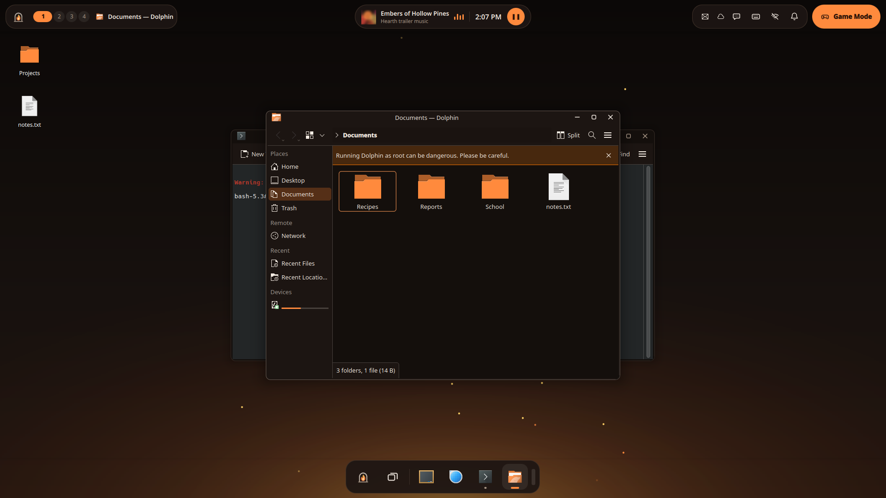

## ph-74b-tray-and-pill-close

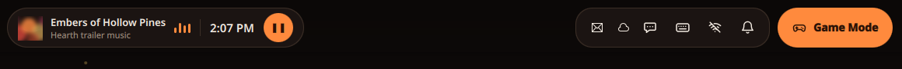

## ph-75-dashboard-now-playing

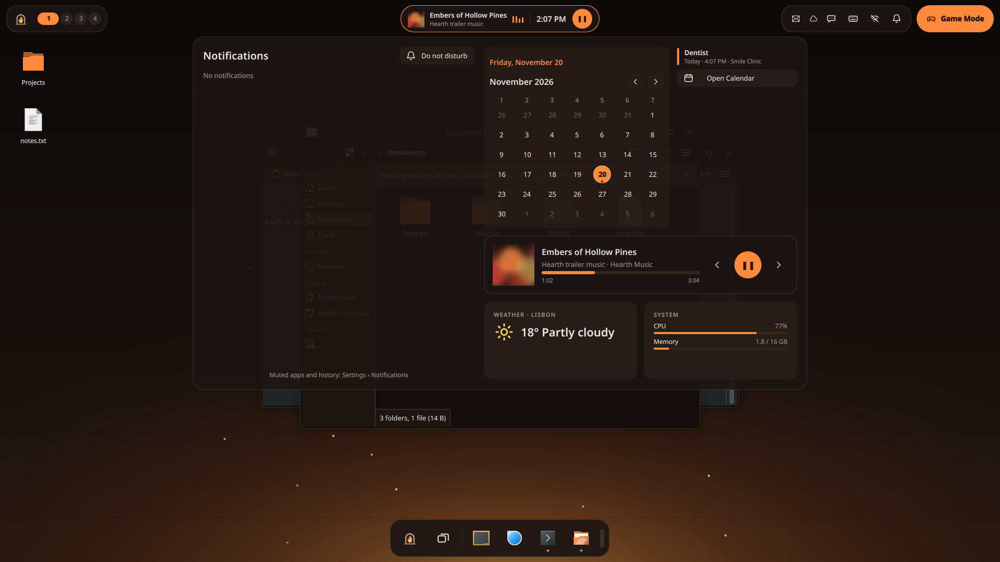

## ph-76-menu-start-now-playing

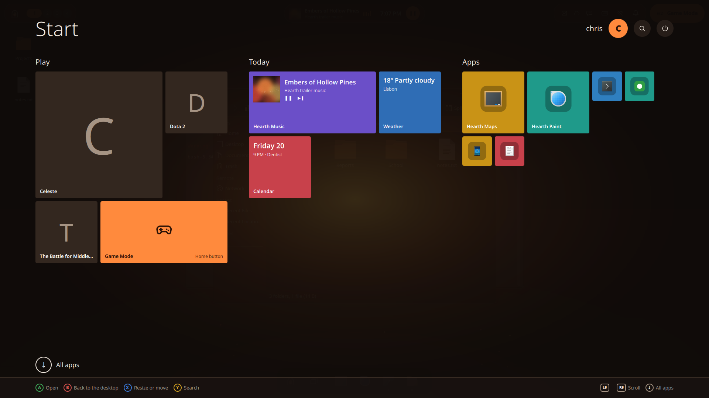

## ph-76-menu-tiles-now-playing

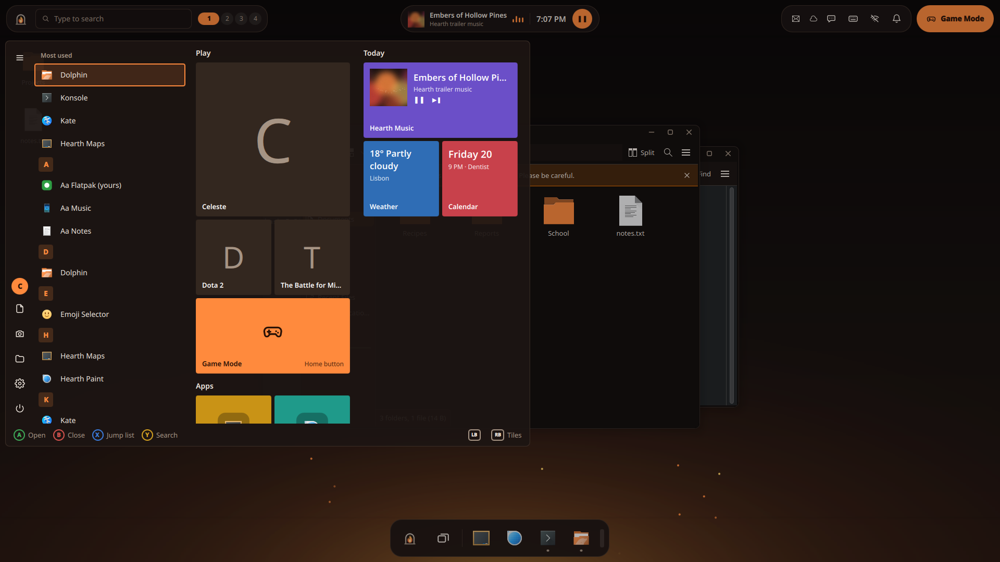

