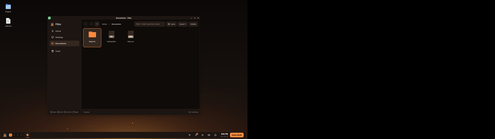
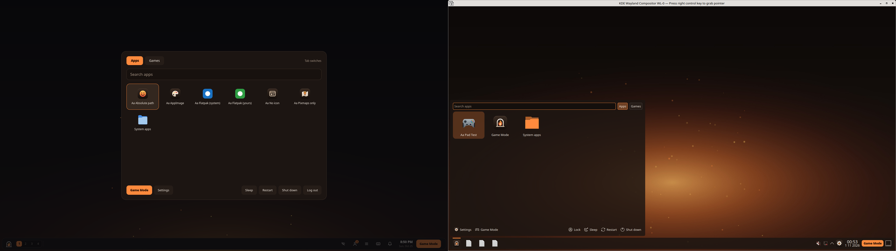
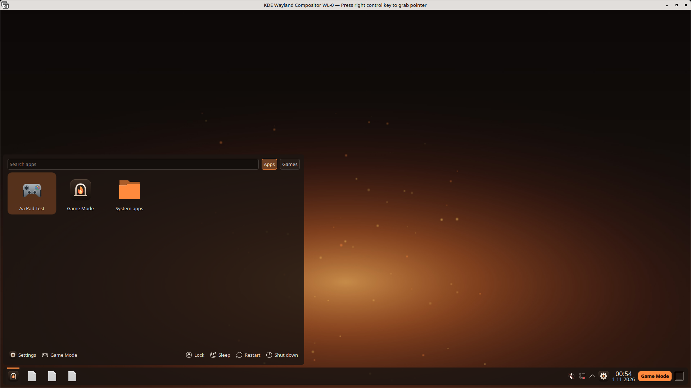
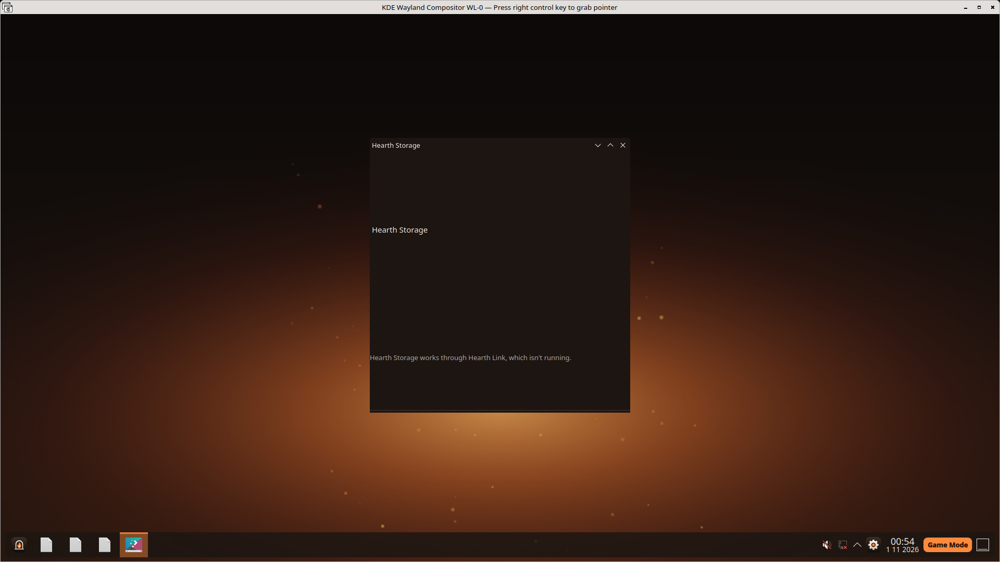
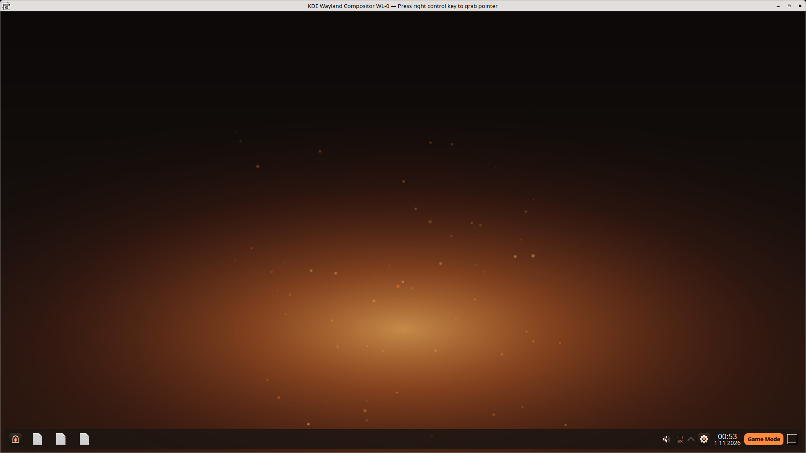
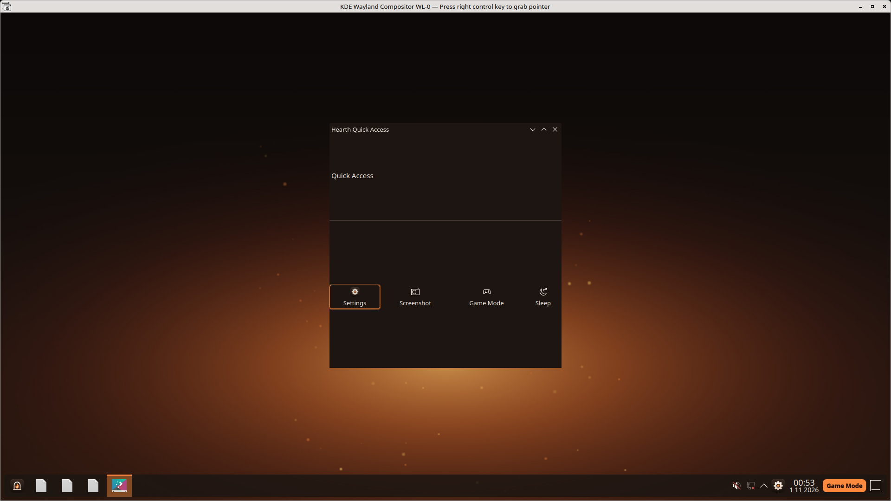
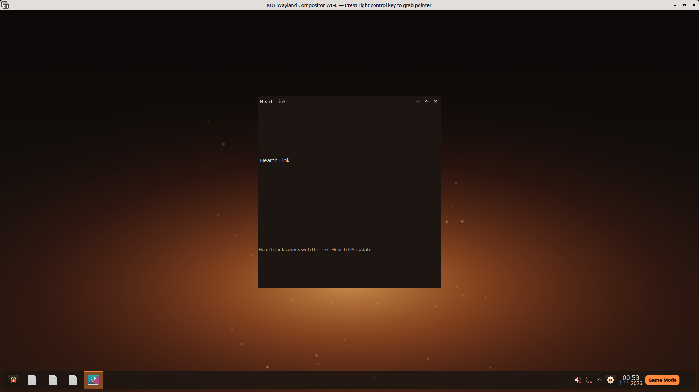
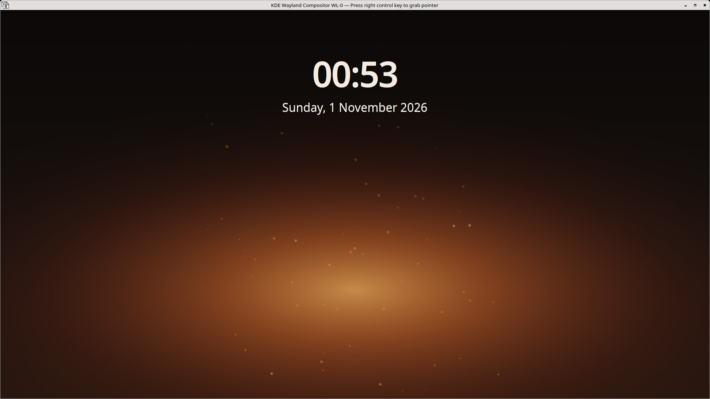

# Hearth Classic (left) and Hearth Plasma (right)

## desktop

## files

## launcher

## quick-access

## Hearth Plasma with a controller (tools/e2e-plasma-pad.py)

- KWin answers through hearth-pad (org.hearth.Pad): FAILED. first probe: None
- right stick moves the pointer: FAILED. cursor None -> None
- View shows the controls: passed. 
- Guide + X asks for the on-screen keyboard: passed. events: [{'t': 'radial', 'open': True, 'sel': -1}, {'t': 'radial', 'open': False, 'pick': -1}, {'t': 'osk', 'open': True}]
- Menu opens Plasma's launcher: FAILED. in front: None
- D-pad and A start an app from the launcher: FAILED. the test app did not start; pad.log says what was in front
- the Hearth menu opens Hearth Quick Access: FAILED. picked: True, in front: None
- B closes it: FAILED. in front: None
- View + B closes the window: passed. in front before: None
- Hearth Files (Dolphin) with the controller: FAILED. in front: None, keys: False, keyboard: True, closed with View + B: True
- Terminal (Konsole) with the controller: FAILED. in front: None, keys: False, keyboard: True, closed with View + B: True
- Text (Kate) with the controller: FAILED. in front: None, keys: False, keyboard: True, closed with View + B: True
- Reader (Okular) with the controller: FAILED. in front: None, keys: False, keyboard: True, closed with View + B: True
- Calculator (KCalc) with the controller: FAILED. in front: None, keys: False, keyboard: True, closed with View + B: True
- Capture (Spectacle) with the controller: FAILED. in front: None, keys: False, keyboard: True, closed with View + B: True

## Hearth Plasma

