# Hearth Classic / Mantel (left) and Hearth COSMIC (right)

## Hearth COSMIC

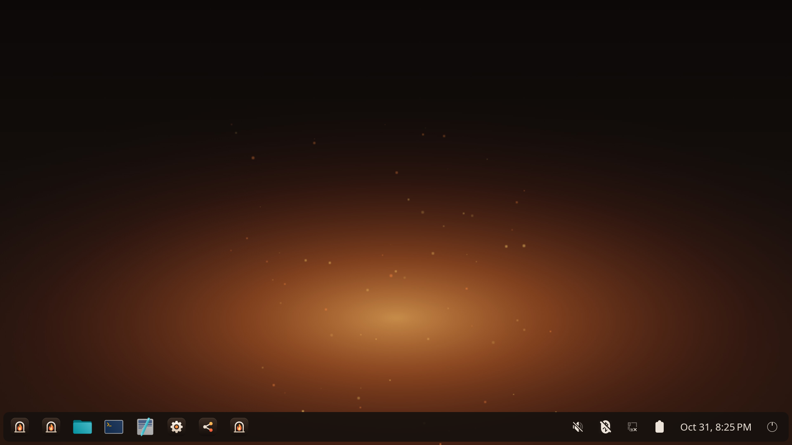

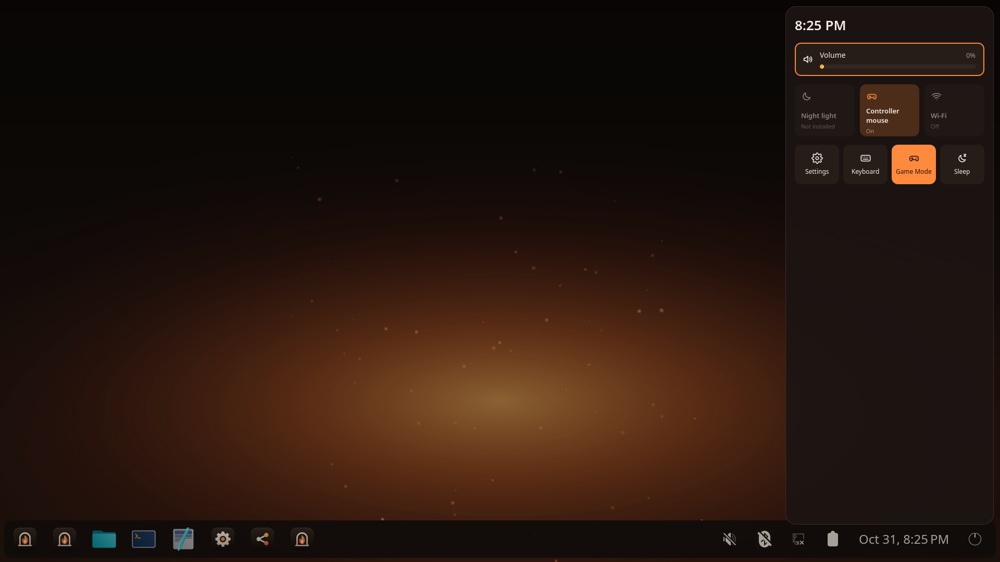

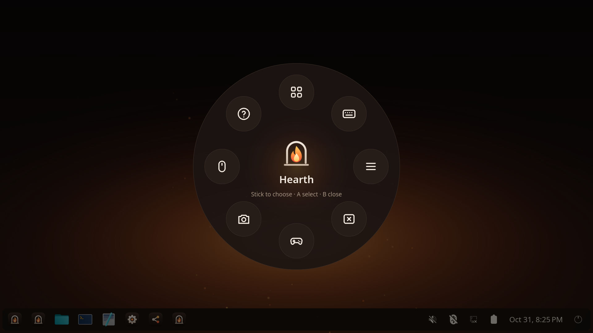

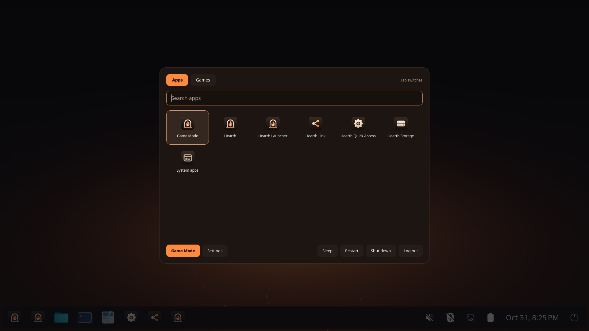

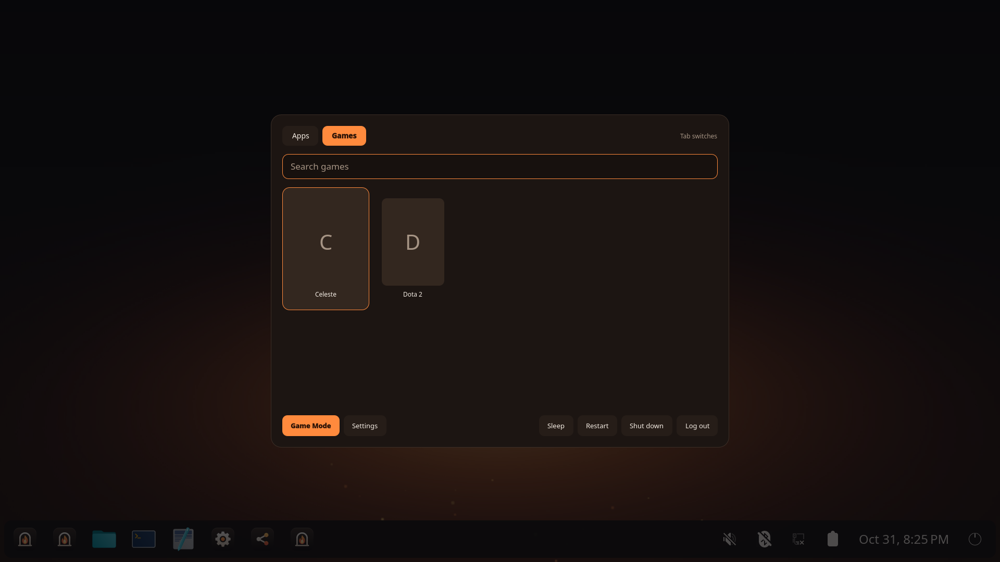

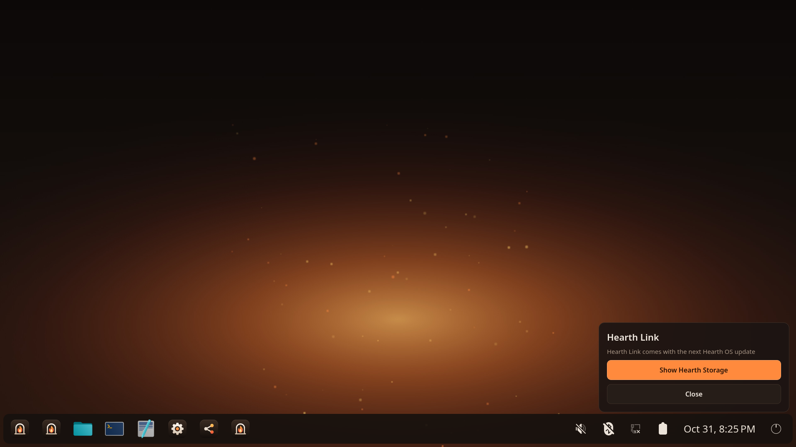

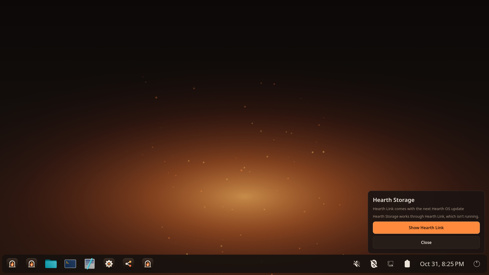

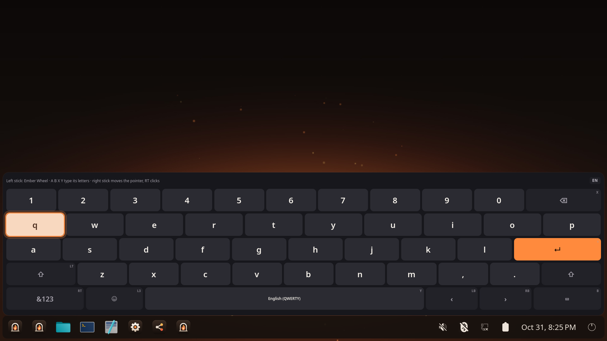


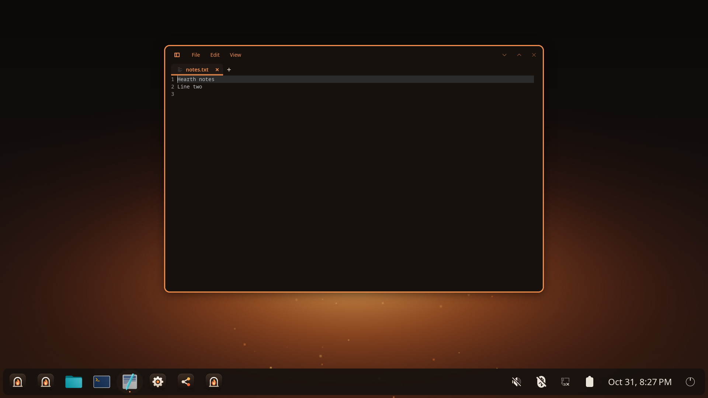

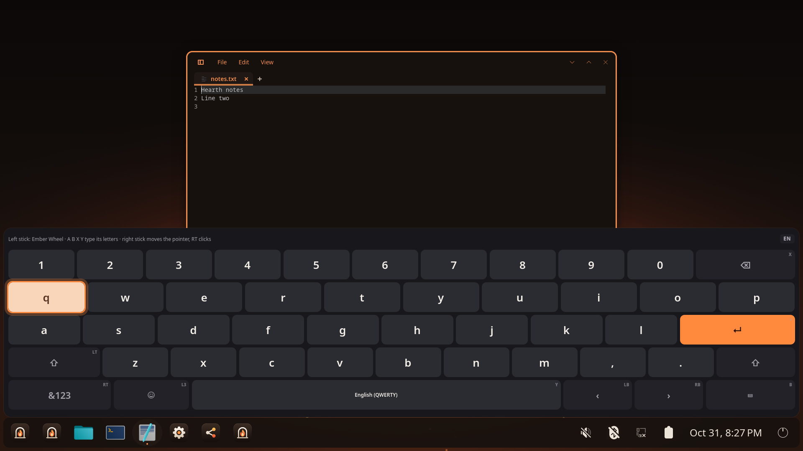

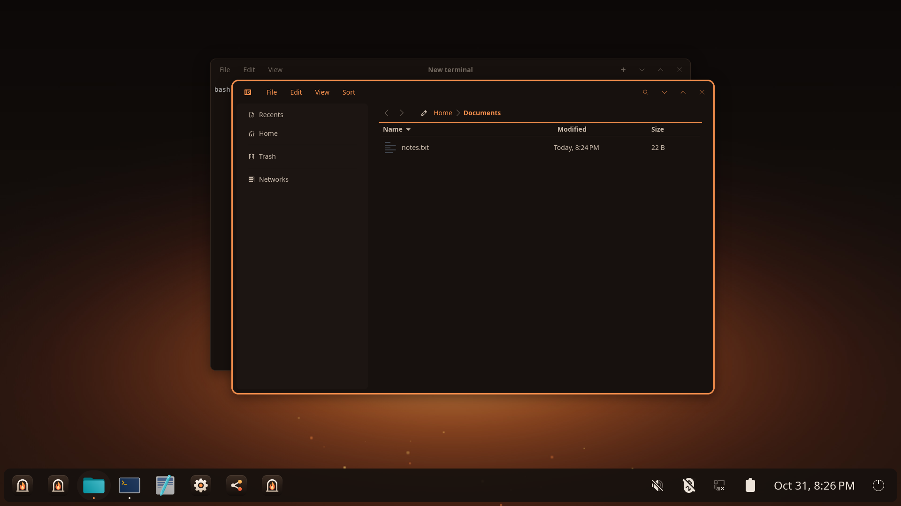


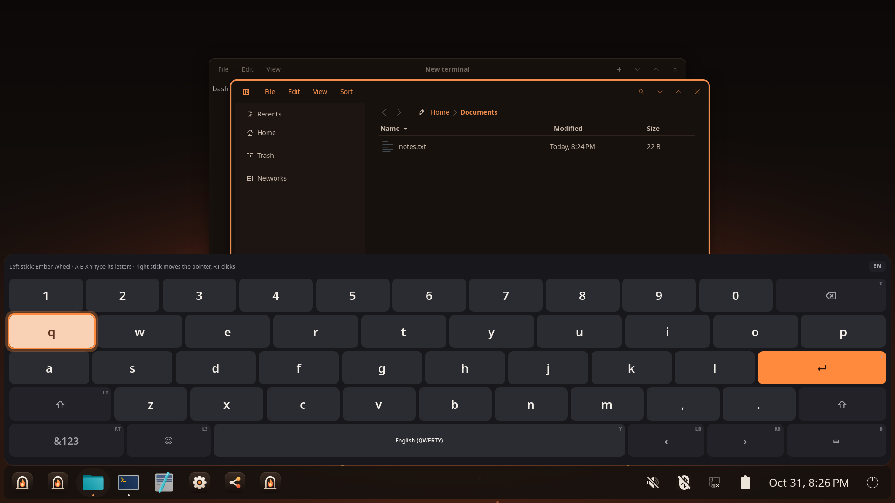


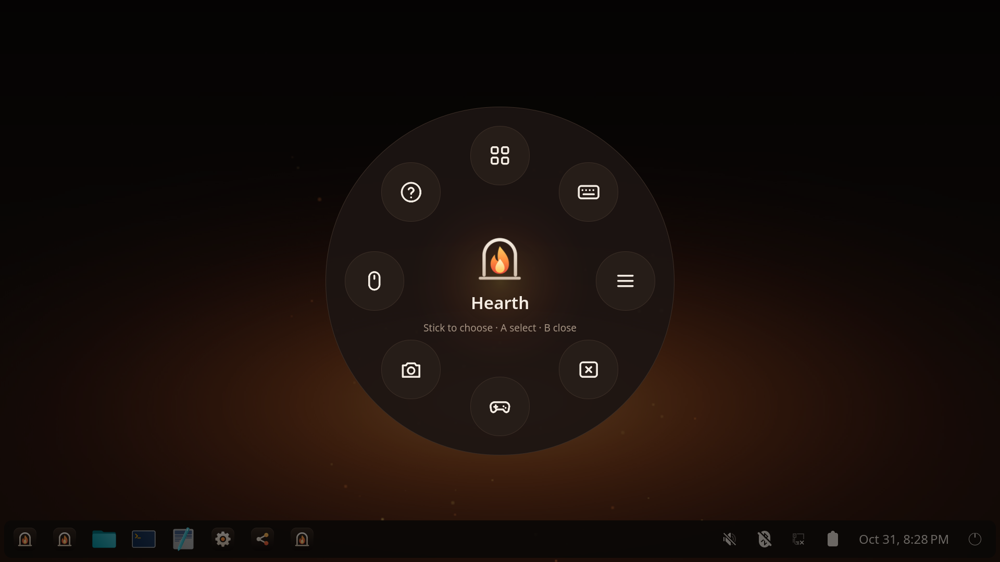


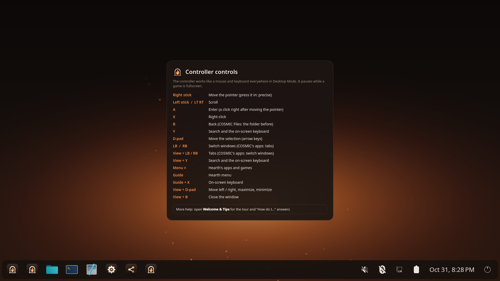

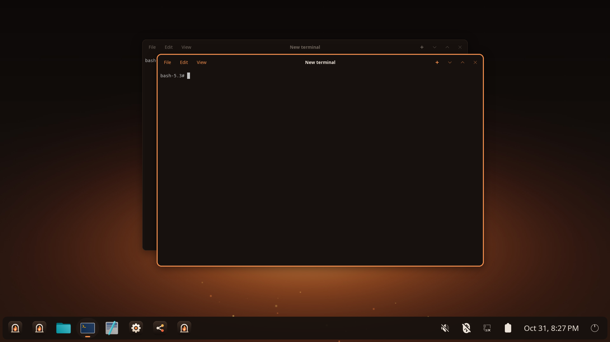

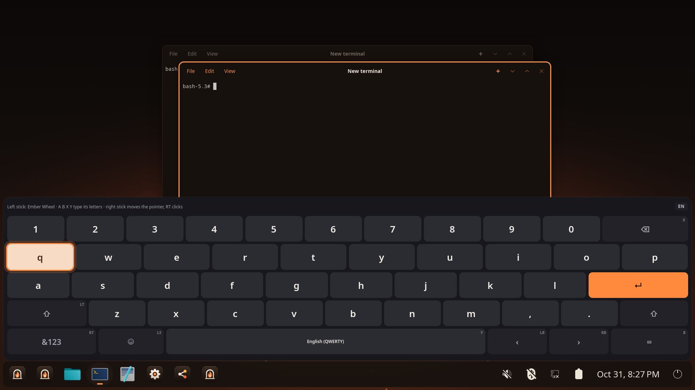


## Results

```
ok COSMIC's size: COSMIC adds 867 MB installed on plain Fedora 45 (Anatase already has some of it). Biggest: cosmic-files 76MB, cosmic-applets 59MB, cosmic-settings 59MB, cosmic-initial-setup 42MB, xdg-desktop-portal-cosmic 39MB, cosmic-edit 39MB, cosmic-term 37MB, cosmic-greeter 36MB, gtk4 29MB, cosmic-app-library 29MB, cosmic-launcher 27MB, cosmic-comp 26MB, 
ok cosmic-comp: nested on wayland-1
ok files app id: the companion sees: 
ok term app id: the companion sees: 
ok edit app id: the companion sees: 
app the companion sees: ''
ok Guide: the Hearth menu: expected None, got keys [], pointer {'move': 0, 'wheel': 0}, buttons []
ok B closes it: expected None, got keys [], pointer {'move': 0, 'wheel': 0}, buttons []
ok Menu: Hearth launcher: expected None, got keys [], pointer {'move': 0, 'wheel': 0}, buttons []
ok D-pad in the launcher: expected KEY_RIGHT, got keys ['KEY_RIGHT'], pointer {'move': 0, 'wheel': 0}, buttons []
ok B (Esc) closes it: expected KEY_ESC, got keys ['KEY_ESC'], pointer {'move': 0, 'wheel': 0}, buttons []
ok View: the controls: expected None, got keys [], pointer {'move': 0, 'wheel': 0}, buttons []
ok View + B closes the window (Super+Q): expected KEY_LEFTMETA+KEY_Q, got keys ['KEY_LEFTMETA+KEY_Q'], pointer {'move': 0, 'wheel': 0}, buttons []
app the companion sees: ''
ok Y: find and the keyboard: expected None, got keys [], pointer {'move': 0, 'wheel': 0}, buttons []
ok Guide + X closes the keyboard: expected None, got keys [], pointer {'move': 0, 'wheel': 0}, buttons []
ok B: Esc: expected KEY_ESC, got keys ['KEY_ESC'], pointer {'move': 0, 'wheel': 0}, buttons []
ok D-pad right moves the caret: expected KEY_RIGHT, got keys ['KEY_RIGHT'], pointer {'move': 0, 'wheel': 0}, buttons []
app the companion sees: ''
ok D-pad down moves the selection: expected KEY_DOWN, got keys ['KEY_DOWN'], pointer {'move': 0, 'wheel': 0}, buttons []
ok D-pad down again: expected KEY_DOWN, got keys ['KEY_DOWN'], pointer {'move': 0, 'wheel': 0}, buttons []
ok RB: next window: expected KEY_LEFTALT+KEY_TAB, got keys ['KEY_LEFTALT+KEY_TAB'], pointer {'move': 0, 'wheel': 0}, buttons []
ok Y: search and the keyboard: expected None, got keys [], pointer {'move': 0, 'wheel': 0}, buttons []
ok Guide + X closes the keyboard: expected None, got keys [], pointer {'move': 0, 'wheel': 0}, buttons []
ok B: back: expected KEY_ESC, got keys ['KEY_ESC'], pointer {'move': 0, 'wheel': 0}, buttons []
ok A: open: expected KEY_ENTER, got keys ['KEY_ENTER'], pointer {'move': 0, 'wheel': 0}, buttons []
ok RT scrolls: expected None, got keys [], pointer {'move': 0, 'wheel': -8}, buttons []
ok Right stick moves the pointer: expected None, got keys [], pointer {'move': 729, 'wheel': 0}, buttons []
ok A right after moving clicks: expected None, got keys [], pointer {'move': 136, 'wheel': 0}, buttons ['BTN_LEFT']
ok X: right-click menu: expected None, got keys [], pointer {'move': 0, 'wheel': 0}, buttons ['BTN_RIGHT']
ok B closes it: expected None, got keys ['KEY_ESC'], pointer {'move': 0, 'wheel': 0}, buttons []
app the companion sees: ''
ok Y: the on-screen keyboard: expected None, got keys [], pointer {'move': 0, 'wheel': 0}, buttons []
ok A on the keyboard types a key: expected None, got keys ['KEY_Q'], pointer {'move': 0, 'wheel': 0}, buttons []
ok Guide + X closes it: expected None, got keys [], pointer {'move': 0, 'wheel': 0}, buttons []
ok A: Enter: expected KEY_ENTER, got keys ['KEY_ENTER'], pointer {'move': 0, 'wheel': 0}, buttons []
ok LB: window: expected KEY_LEFTALT+KEY_LEFTSHIFT+KEY_TAB, got keys ['KEY_LEFTALT+KEY_LEFTSHIFT+KEY_TAB'], pointer {'move': 0, 'wheel': 0}, buttons []
```
