# Hearth Games desktop icons on the desktops, cb0a5c1

## mantel-1-before

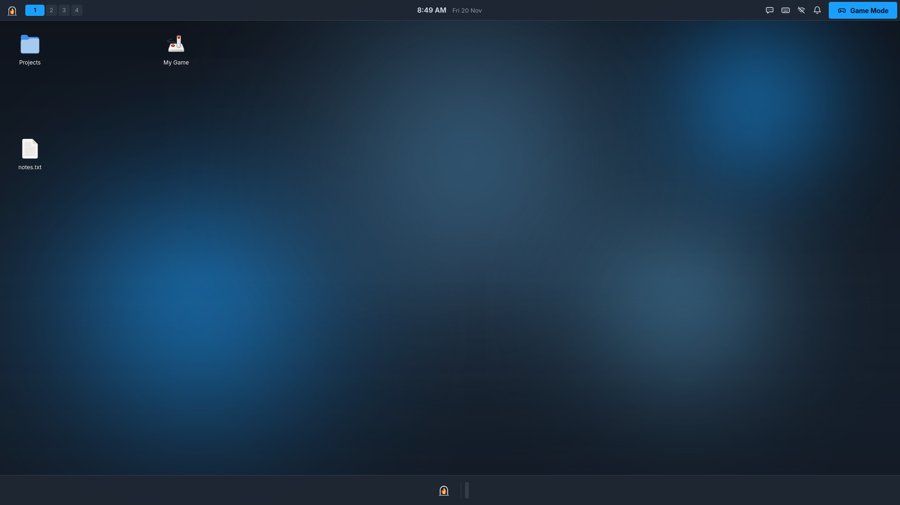

## mantel-2-icon-added

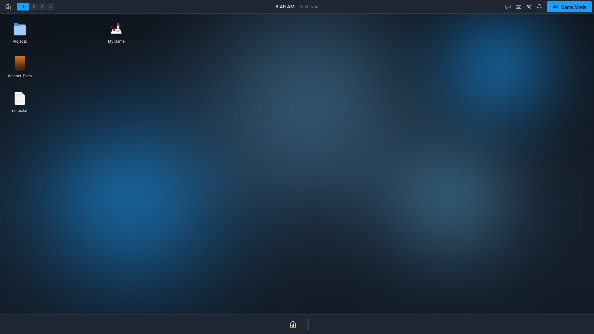

## mantel-3-after-uninstall

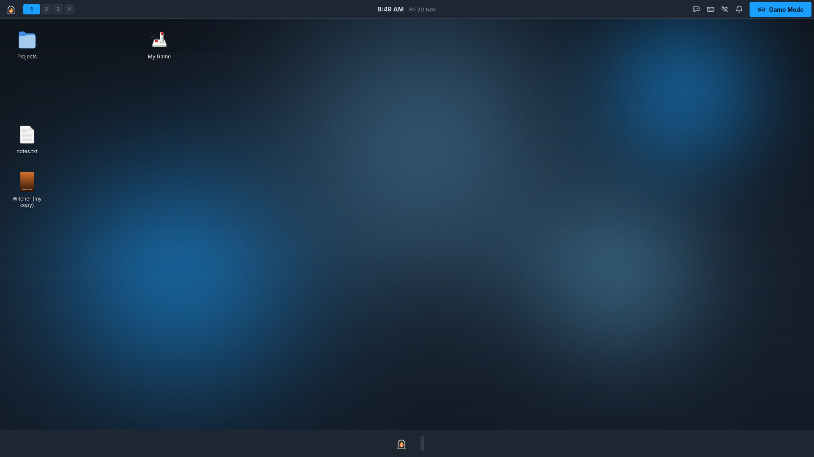

## mantel-4-firehold-desk-icon

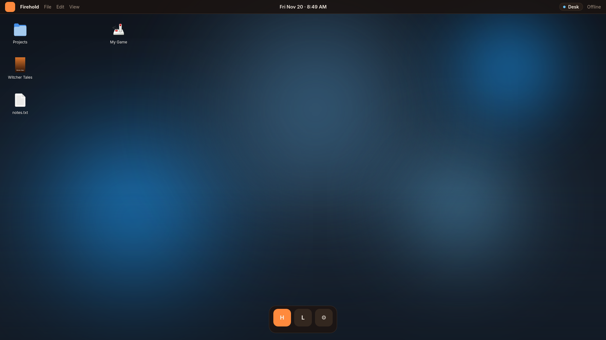

## plasma-1-before

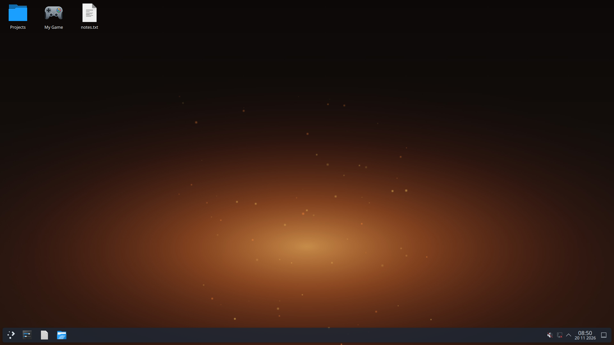

## plasma-2-icon-added

## plasma-2a-after-restart

## plasma-2b-after-open

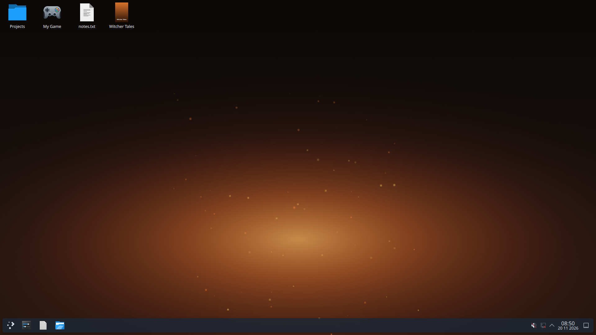

## plasma-3-hearth-panel-icon-added

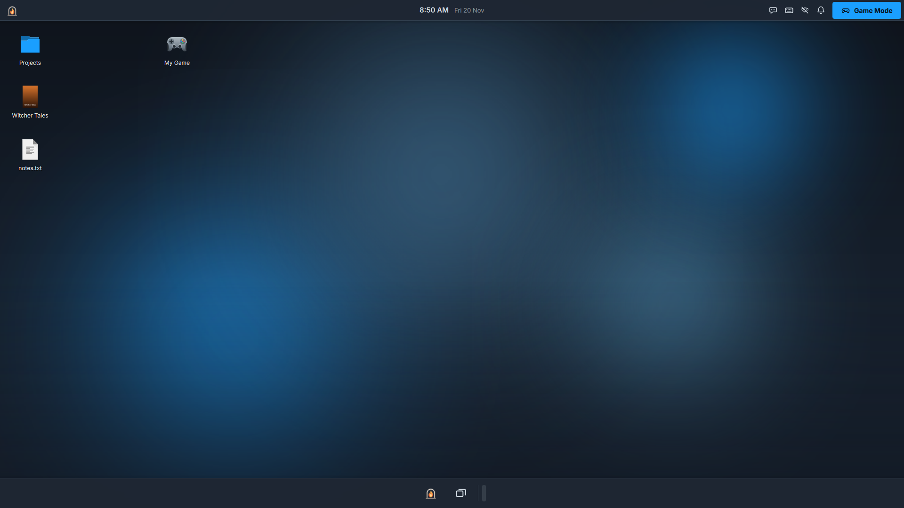

## plasma-4-hearth-panel-after-uninstall

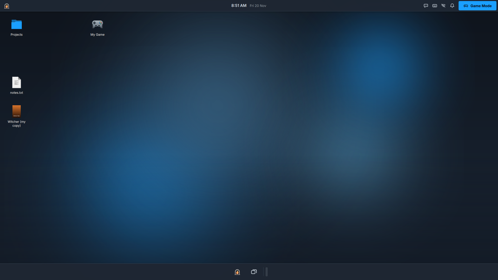

## plasma-5-kde-after-uninstall

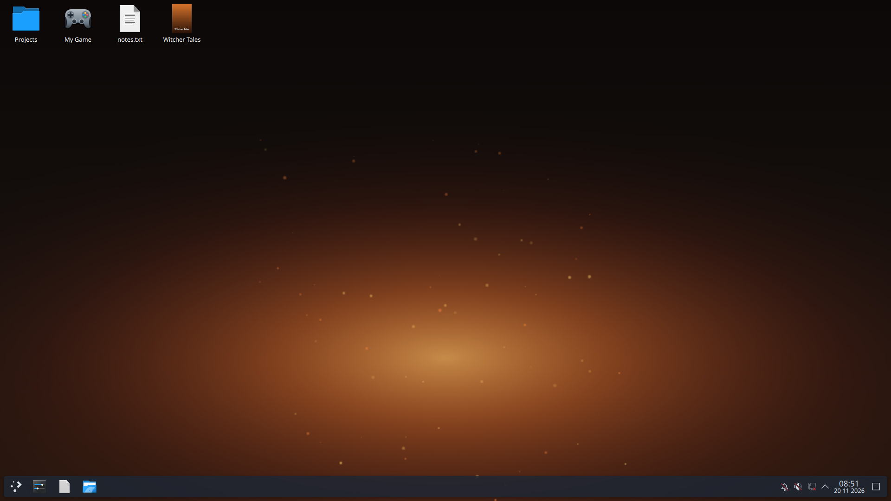

## plasma-6-stale-menu-entry-notice

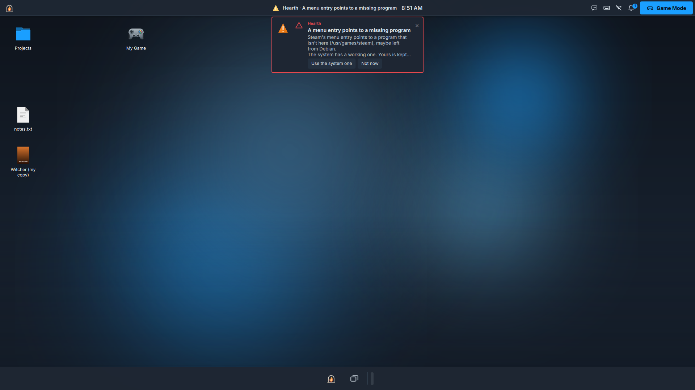

## plasma-6b-stale-notice-in-dashboard

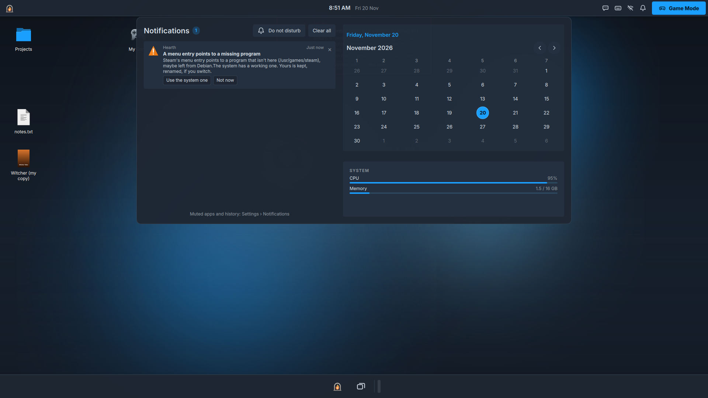

