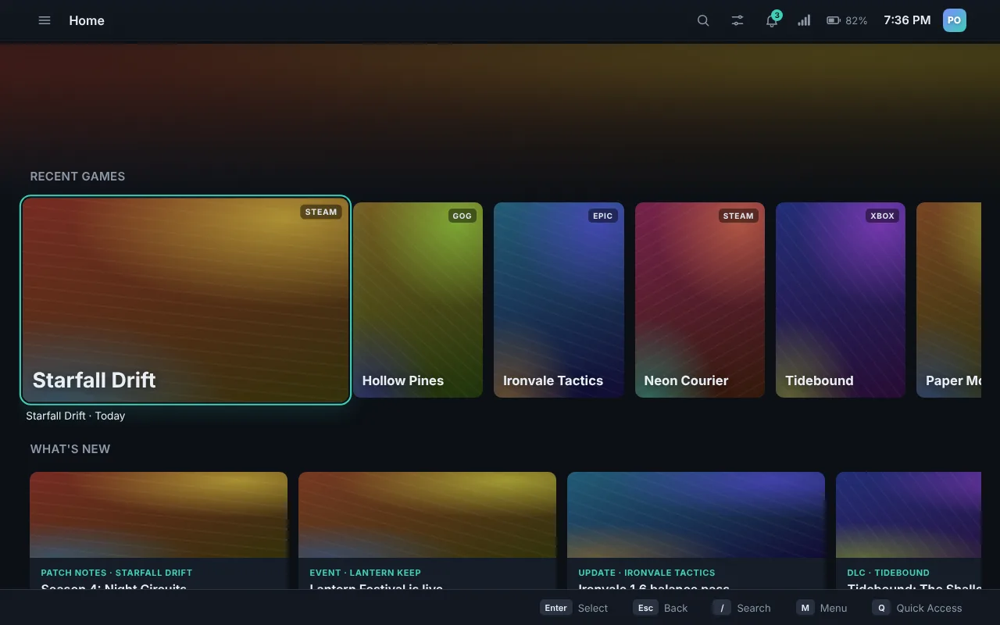
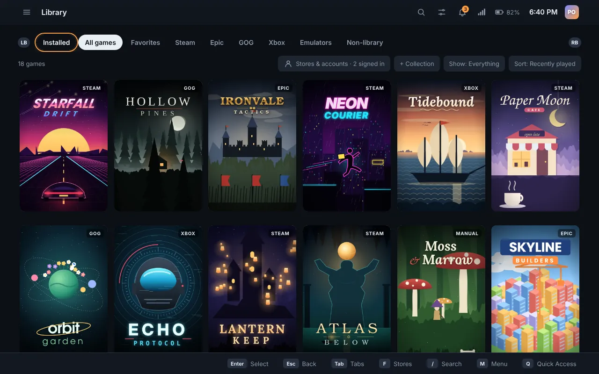
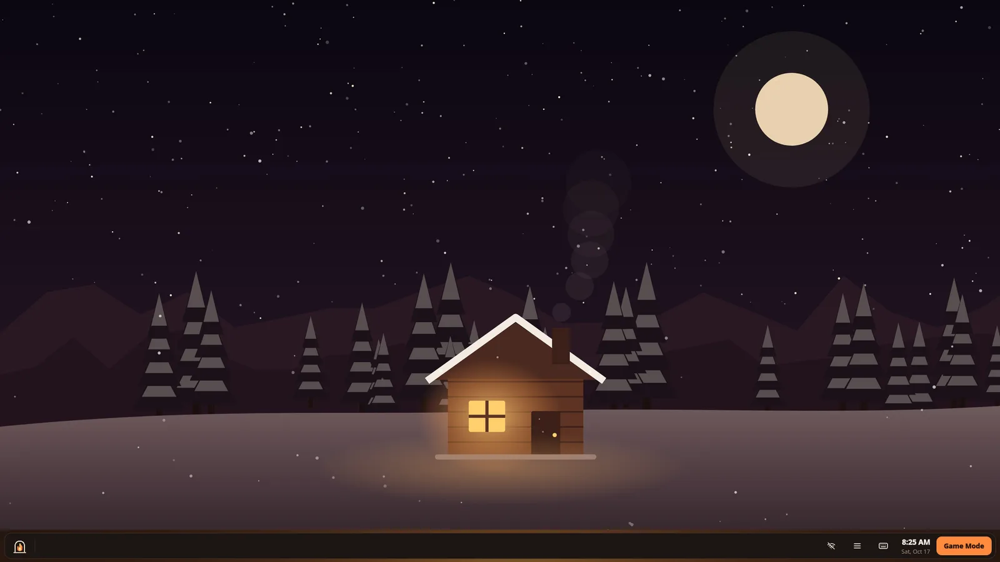

<p align="center">
  
</p>

<h1 align="center">Hearth OS</h1>

<p align="center">
  <b>Your whole library, by the fire.</b><br>
  A controller-first gaming system for handhelds and PCs: Steam, Epic, GOG and Xbox Cloud Gaming in one library you drive with a gamepad, and a full desktop one button away.
</p>

<p align="center">
  <a href="https://dragongamer9.github.io/hearth-os/"><b>Website</b></a> ·
  <a href="https://dragongamer9.github.io/hearth-os/#download"><b>Download</b></a> ·
  <a href="https://github.com/Dragongamer9/hearth-os/releases"><b>Releases</b></a> ·
  <a href="docs/ROADMAP.md"><b>Roadmap</b></a> ·
  <a href="https://github.com/Dragongamer9/hearth-os/issues"><b>Report a problem</b></a>
</p>

<p align="center">
  <a href="https://github.com/Dragongamer9/hearth-os/releases/latest"></a>
  
  
  
</p>

<p align="center">
  
</p>

> **Beta.** Hearth OS and Ember are still being built and aren't ready to be your everyday system yet. Updates come out often and install themselves from Settings › Updates. Keep a backup of anything important.

## What's in it

| | |
|---|---|
| 🎮 **Game Mode** | One library for Steam, Epic, GOG, Xbox Cloud Gaming, emulators and your own games. Install, play and uninstall Epic and GOG games without their launchers. Quick Resume keeps several games paused in memory, the way SteamOS and Xbox do. |
| 🕹️ **Hearth Input** | Play games that have no controller support: per-game controller layouts turn the controller into a keyboard and mouse, with ready-made layouts for shooters, strategy and retro games, gyro aiming and back paddles. *(Beta Experimental)* |
| 🖥️ **Mantel** | A real desktop, still in reach of your thumbs: pinned apps, window snapping, Alt+Tab, virtual desktops, desktop icons, Bazaar for Flathub apps, clipboard history and full settings. |
| ⚡ **Handhelds** | Built on Anatase with Handheld Daemon: every controller, gyro, power, fan and light setting inside Hearth, and Quick Access over games for power, frame rate and more. ROG Ally, Legion Go, Steam Deck and most desktops and laptops. |
| 🛋️ **Play together** | Couch Co-op splits one screen for 2–4 players, even in games without split-screen; Multi-seat gives each screen its own Game Mode. *(Beta Experimental)* |
| 🏰 **Beacon** | [Beacon](https://github.com/Dragongamer9/beacon), the launcher for Battle for Middle-earth, Age of the Ring, LOTR: Conquest and other classics, built right into the library with its mods. |
| 🔄 **Looks after itself** | An image-based system: the whole OS updates as one piece in the background, and a bad update is undone by picking the previous entry at start. |

<p align="center">
  
  
</p>

## Editions

| Edition | Base | Status |
|---|---|---|
| **Hearth OS** | [Anatase](https://anatase.org) (Fedora, image-based), one image for AMD, Intel and Nvidia | Main edition |
| Hearth OS on Ubuntu | Ubuntu 26.04 LTS, without snaps | Archived for now |
| Hearth OS on CachyOS | CachyOS, performance-tuned | Archived for now |
| Hearth OS on Peppermint | Peppermint OS on Debian 13 | Beta Experimental |
| **Ember** | Windows 11 (replaces Explorer, or runs on top of it) | Beta |
| Hearth for Android | An app on Android 8.0+ phones, handhelds and TVs | **Archived** (on hold; the code stays in `hosts/android`) |

Hearth OS on Bazzite is archived: 0.1.3 was its last update, and it moves to the new Hearth OS from Settings › Updates.

## Get it

- **ISO (offline installer, one for every graphics card):** coming soon on the [website](https://dragongamer9.github.io/hearth-os/#download).
- **Already on Bazzite, Bluefin, Aurora or Fedora Atomic?** Switch with one command, then restart *(Beta Experimental)*:
  ```sh
  sudo bootc switch ghcr.io/dragongamer9/hearth-os:latest
  ```
  Going back: pick the previous entry in the boot menu, or `sudo bootc rollback`.
- **On Hearth OS on Bazzite:** Settings › Updates › Move to a new Hearth OS.
- **Ember for Windows 11** (PowerShell):
  ```powershell
  irm https://raw.githubusercontent.com/Dragongamer9/hearth-os/main/tools/install-nimbus.ps1 | iex
  ```
- **Hearth app on another Linux:** the [AppImage](https://github.com/Dragongamer9/hearth-os/releases/latest/download/Nimbus-linux-x86_64.AppImage).
- **Hearth for Android** *(archived)*: on hold while the focus is Hearth OS and Ember. The code stays in `hosts/android` ([docs/ANDROID.md](docs/ANDROID.md)); its build only runs by hand. The last APK is on the v0.2.2 release.

## Try the interface in a browser

Open `ui/index.html` in Chrome or Edge: it runs against a built-in demo library. Plug in an Xbox-style controller and press any button, or use the keyboard.

| Action | Controller | Keyboard |
|---|---|---|
| Move | D-pad / left stick | Arrow keys or W A S D |
| Select | A | Enter / Space |
| Back | B | Esc / Backspace |
| Main menu | Start (☰) | M |
| Quick Access | View (⧉) | Q |
| Search | Y | / |
| Switch tabs | LB / RB | Tab / Shift+Tab, [ ] |

## For developers

```
hearth-os/
  ui/index.html            The whole interface (HTML/CSS/JS), shared by every host; runs in any browser
  hosts/hearth-core/       Rust: the library, stores, Quick Resume, Handheld Daemon, power, settings bridge
  hosts/hearth-rs/         Rust: the Linux app (Tauri v2), Game Mode inside gamescope
  hosts/linux/             Linux session, Mantel (labwc + Quickshell) and helpers; the Electron app (overlay)
  os/system_files/usr/share/hearth-browser/  Hearth Browser: Mozilla's Firefox with Hearth's settings (Linux and Windows)
  hosts/windows/           Ember: .NET 8 + WebView2 host
  hosts/android/           Hearth for Android: Kotlin + WebView host
  os/                      Shared system files, the live ISO (os/live) and the small installer (os/installer)
  os-bases/                The editions: anatase, ubuntu, cachyos, peppermint (bootc images)
  site/                    The website (GitHub Pages)
  docs/                    Design notes and guides
```

- **The bridge** between the interface and a host: [docs/bridge.md](docs/bridge.md)
- **Linux app and session:** [hosts/linux/README.md](hosts/linux/README.md) · **the OS:** [os/README.md](os/README.md) · **Rust host:** [docs/RUST.md](docs/RUST.md)
- **Editions:** [Anatase](docs/BASE-ANATASE.md) · [Peppermint](docs/BASE-PEPPERMINT.md) · archived for now: [Ubuntu](docs/BASE-UBUNTU.md), [CachyOS](docs/BASE-CACHYOS.md)
- **Features:** [Couch Co-op](docs/COUCH-COOP.md) · [Multi-seat](docs/MULTI-SEAT.md) · [Moving games and growing Hearth](docs/MOVE-AND-GROW.md) · [Beacon](docs/BEACON.md) · [Mantel](docs/MANTEL-PARITY.md)
- **Ember (Windows):** [docs/EMBER.md](docs/EMBER.md)
- **Hearth for Android:** [docs/ANDROID.md](docs/ANDROID.md)

Every push is built and tested on GitHub Actions; a version bump on `main` is a release, and it only ships if it can update itself.

The project used to be called Nimbus. Internal names (program files, data folders like `~/.config/nimbus`, release file names) stay "Nimbus" so existing installs keep updating.

## License

Hearth OS (including Ember, Mantel and Hearth's apps) is free software, licensed under the **GNU General Public License v3.0 or later** ([LICENSE](LICENSE)). You may use, study, share and change it; if you share a changed version, it must stay under the same license with its source available.

Parts that come from other projects keep their own licenses (for example the Linux base images, gamescope, Handheld Daemon, and the libraries the apps are built with).

Hearth OS is an independent project, not affiliated with Valve, Epic Games, GOG, Microsoft, Universal Blue or the Anatase project. Steam, Epic Games, GOG and Xbox are trademarks of their owners.
