# Hearth Classic (left) and Hearth Plasma (right)

## desktop

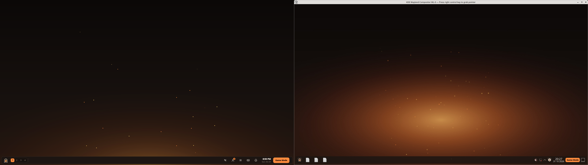

## files

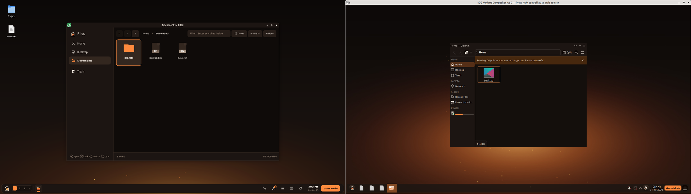

## launcher

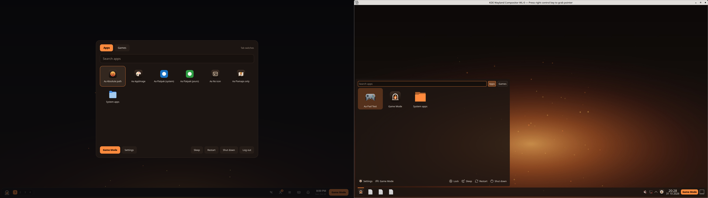

## quick-access

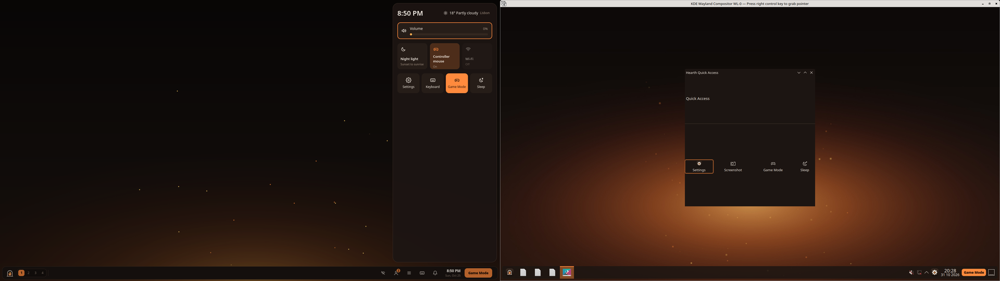

## Hearth Plasma with a controller (tools/e2e-plasma-pad.py)

- KWin answers through hearth-pad (org.hearth.Pad): passed. first probe: {'x': 959, 'y': 526, 'cls': 'plasmashell', 'caption': '', 'kind': 'desktop'}
- right stick moves the pointer: passed. cursor (959, 526) -> (1070, 1044)
- View shows the controls: passed. 
- Guide + X asks for the on-screen keyboard: passed. events: [{'t': 'radial', 'open': True, 'sel': -1}, {'t': 'radial', 'open': False, 'pick': -1}, {'t': 'osk', 'open': True}]
- Menu opens Plasma's launcher: passed. in front: {'x': 1070, 'y': 1044, 'cls': 'org.kde.plasmashell', 'caption': 'plasmashell', 'kind': 'popup'}
- D-pad and A start an app from the launcher: passed. the test app started; pad.log says what was in front
- the Hearth menu opens Hearth Quick Access: passed. picked: True, in front: {'x': 1070, 'y': 1044, 'cls': 'org.kde.plasmashell', 'caption': 'plasmashell', 'kind': 'popup'}
- B closes it: passed. in front: {'x': 1070, 'y': 1044, 'cls': 'plasmashell', 'caption': '', 'kind': 'desktop'}
- View + B closes the window: passed. in front before: {'x': 1070, 'y': 1044, 'cls': 'org.kde.plasmawindowed', 'caption': 'Hearth Storage', 'kind': 'normal'}
- Hearth Files (Dolphin) with the controller: passed. in front: 'org.kde.dolphin', keys: True, keyboard: True, closed with View + B: True
- Terminal (Konsole) with the controller: passed. in front: 'org.kde.konsole', keys: True, keyboard: True, closed with View + B: True
- Text (Kate) with the controller: passed. in front: 'org.kde.kate', keys: True, keyboard: True, closed with View + B: True
- Reader (Okular) with the controller: passed. in front: 'org.kde.okular', keys: True, keyboard: True, closed with View + B: True
- Calculator (KCalc) with the controller: passed. in front: 'org.kde.kcalc', keys: True, keyboard: True, closed with View + B: True
- Capture (Spectacle) with the controller: passed. in front: 'org.kde.spectacle', keys: True, keyboard: True, closed with View + B: True

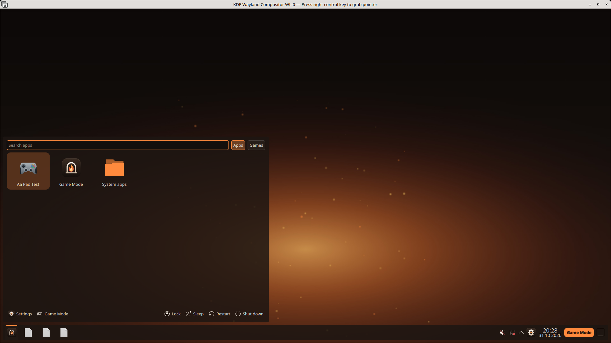

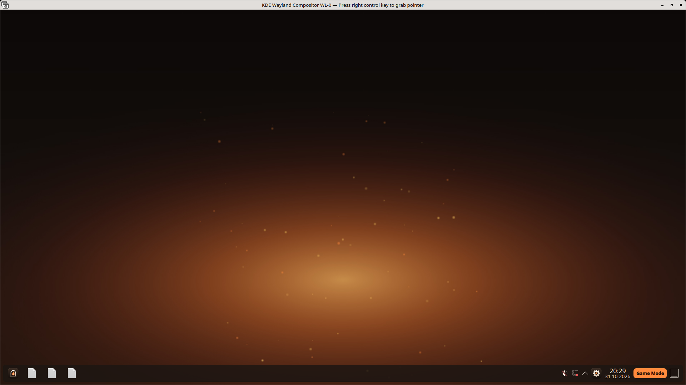

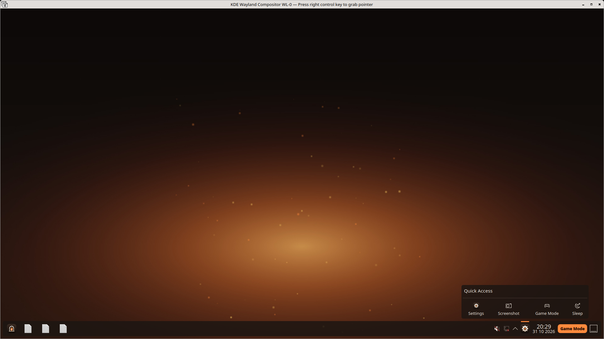

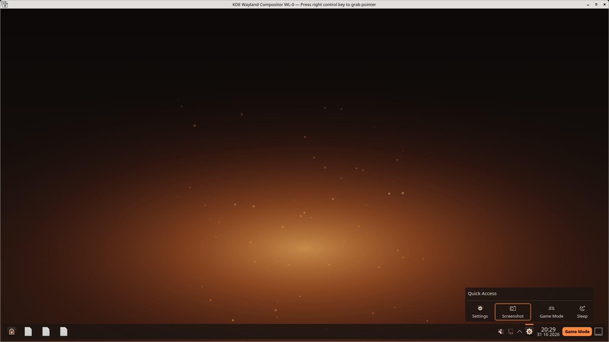

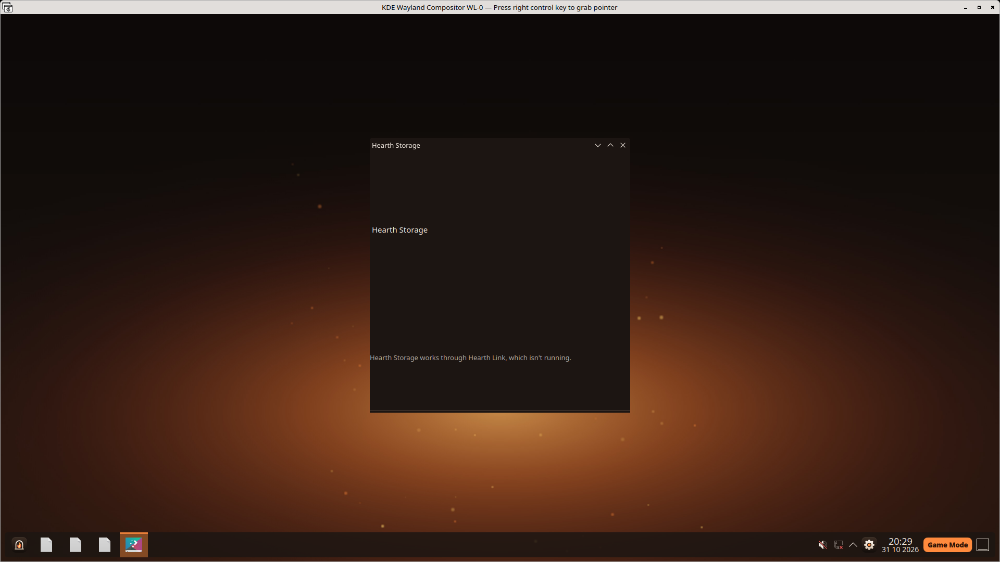

## Hearth Plasma

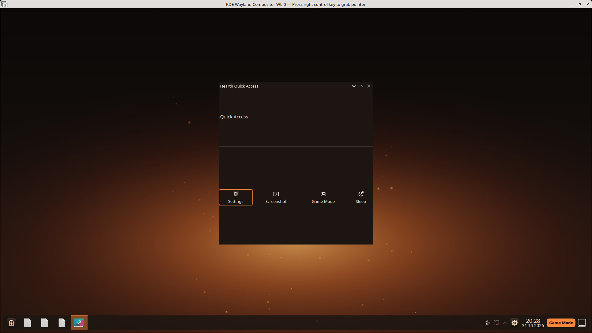

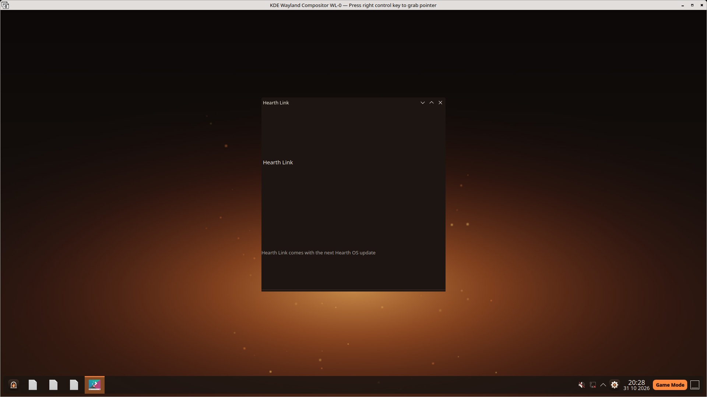

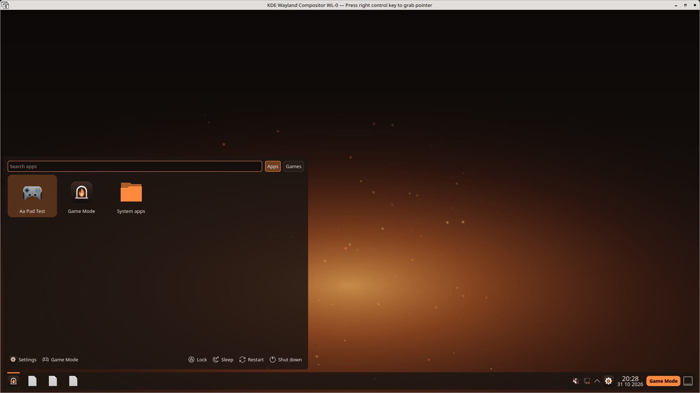

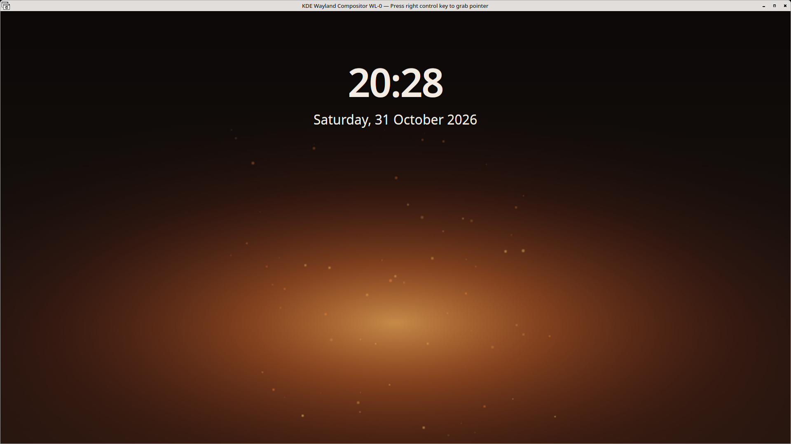

