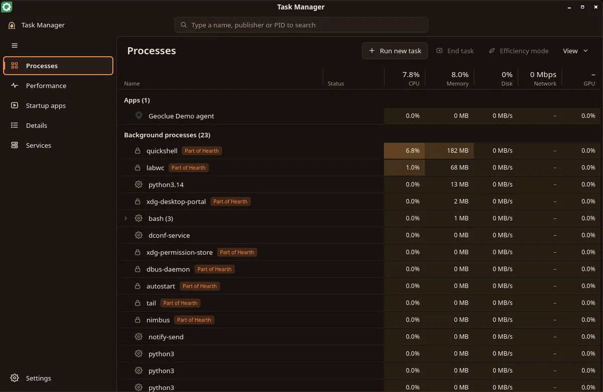

<p align="center">
  
</p>

<h1 align="center">Hearth OS</h1>

<p align="center">
  <b>Steam Game Mode on the couch. Mantel on the desk.</b><br>
  A free, Debian-based OS for gaming PCs and handhelds.
</p>

<p align="center">
  <a href="https://hearthos.fun"><b>Website</b></a> ·
  <a href="https://hearthos.fun/#download"><b>Download</b></a> ·
  <a href="https://hearthos.fun/docs/"><b>Docs</b></a> ·
  <a href="https://hearthos.fun/docs/releases.html"><b>Release notes</b></a> ·
  <a href="docs/ROADMAP.md"><b>Roadmap</b></a> ·
  <a href="https://github.com/Dragongamer9/hearth-os/issues"><b>Report a problem</b></a>
</p>

<p align="center">
  <a href="https://github.com/Dragongamer9/hearth-os/releases/latest"></a>
  
  <a href="LICENSE"></a>
</p>

<p align="center">
  
</p>

Hearth OS starts straight into **Steam Game Mode**, the same full-screen gamepad interface SteamOS uses. Your games
from other stores show up in Steam's library too, and **Mantel**, Hearth's own desktop, is one press away. It's built
on Debian 13, updates as one piece, and always keeps the version before so a bad update can't strand you.

## What you get

- **Steam Game Mode** as the Game Mode, ready for the controller. If Steam can't start, Mantel opens with the reason
  and a button to try again. Prefer Hearth's own screens? **Hearth Game Mode** is a choice in Settings › Gaming.
- **Hearth Sync** (a small Decky plugin) puts your games from outside Steam into Steam's library with their covers:
  Epic and GOG (Heroic, Minigalaxy), Battle.net, Xbox Cloud Gaming, emulators, recomps, Beacon and your own.
- **Hearth Games**: free and open games ready to install with one press, offline once they're on your PC.
- **Mantel**, the desktop (labwc + Quickshell): works with a controller, a mouse and keyboard or touch, with a
  Steam-style look, accent colours, light and dark, the Hearth menu on the Guide button and an on-screen keyboard.
- **Windows-like tools**: Hearth Files (tabs, a details pane, previous versions, drive letters with Hearth (C:)
  everywhere), Task Manager (Processes, Performance with settings for every part, App history, Startup, Services,
  Scheduled tasks) and Resource Monitor.
- **Memory that doesn't run out**: compressed memory (zram) sized for each PC, a swap file on the drive when you want
  one, and a memory guard that closes the one program eating memory instead of freezing the PC.
- **Server mode**: your PC as a home server (backups, shared folders, media, AI) with a dashboard you can open from
  your phone; **Hearth Link** pairs all your Hearth devices; **Hearth Storage** shares updates and games between them.
- **Hearth AI Command Center** and AI sharing: the AIs on your PCs, used from any of your devices.
- **Debian 13 underneath**, image-based (bootc): one image for AMD, Intel and Nvidia. A normal writable system (apt and
  .deb files work) that can be locked in Settings.

<p align="center">
  
</p>

## Install

Download both from [hearthos.fun](https://hearthos.fun/#download) and write them to USB sticks (for example with
Hearth Disks, balenaEtcher or Ventoy):

| | | |
|---|---|---|
| **Hearth OS USB** (offline installer, Debian) | about 6 GB | [hearth-os-peppermint.iso](https://pub-f59beb6fa21c421ca4435ee7f42b3de4.r2.dev/hearth-os-peppermint.iso) · [SHA-256](https://pub-f59beb6fa21c421ca4435ee7f42b3de4.r2.dev/hearth-os-peppermint.iso.sha256) |
| **Recovery USB** (reinstall keeping your files, copy files off, start the previous version) | about 5 GB | [hearth-recovery.iso](https://pub-f59beb6fa21c421ca4435ee7f42b3de4.r2.dev/hearth-recovery.iso) · [SHA-256](https://pub-f59beb6fa21c421ca4435ee7f42b3de4.r2.dev/hearth-recovery.iso.sha256) |

The installer needs no internet. Step by step: [hearthos.fun/docs/install.html](https://hearthos.fun/docs/install.html).

## Updates and going back

- The whole system updates as one piece in the background. Check for updates from Steam's own settings or from
  Settings › System › Updates; the device never restarts by itself.
- The previous version always stays in the boot menu. Pick it to go back, or use Settings › System › Updates.
- A version that fails to start twice in a row goes back by itself. Holding **Volume Down** while it starts opens
  Hearth Recovery, so a handheld can be rescued without a keyboard.
- If nothing starts, the Recovery USB can start the previous version or reinstall while keeping your files.

More: [hearthos.fun/docs/updates.html](https://hearthos.fun/docs/updates.html).

## Version numbers

Versions are **MAJOR.MINOR** with a release date: 1.0, 1.1 … 1.10, 1.11, and 2.0 for the next big change. Build files
and git tags use three parts (`1.11.0`). The release badge at the top shows the version that's out now; what each
version brought is in the [release notes](https://hearthos.fun/docs/releases.html), and what's coming next is in the
[roadmap](docs/ROADMAP.md).

## Hearth on other devices

- **Ember** is Hearth on Windows 11 (below).
- **Hearth for Android** runs Hearth's screens on a tablet or phone: [docs/ANDROID.md](docs/ANDROID.md).
- **The ARM build** (`hearth-peppermint-arm64`) is Hearth OS for ARM PCs and boards.

## Ember (Windows 11)

Ember is Hearth on Windows 11: it replaces Explorer, or runs on top of it, and keeps Hearth's own Game Mode. Get it
from the [latest release](https://github.com/Dragongamer9/hearth-os/releases/latest/download/Nimbus-win-x64.zip) or
in PowerShell:

```powershell
irm https://raw.githubusercontent.com/Dragongamer9/hearth-os/main/tools/install-nimbus.ps1 | iex
```

More: [docs/EMBER.md](docs/EMBER.md).

## Where things are

```
os-bases/peppermint/     The Debian image (bootc): Containerfile, build.sh and its own system files
os/                      Shared system files (os/system_files), the installer USB (os/live), Recovery (os/recovery)
hosts/linux/             The Linux session and Mantel (desktop/shell: Quickshell QML; desktop/labwc; desktop/theme)
hosts/linux/test/        The Linux tests (Python), run on every push
hosts/decky-hearth-sync/ Hearth Sync, the Decky plugin for Steam Game Mode
hosts/hearth-core/       Rust: library, stores, settings, updates, Hearth Link and the rest of Hearth's core
hosts/hearth-rs/         Rust: the Hearth app (Tauri); Hearth Game Mode (a choice next to Steam Game Mode)
hosts/hearth-*/          Hearth's apps (Terminal, Disks, Photos, Text, Tools …)
hosts/windows/           Ember: .NET 8 + WebView2
hosts/android/           Hearth for Android (Kotlin, a WebView for ui/)
ui/                      The web interface shared by Ember and Hearth's own Game Mode
site/                    hearthos.fun (site/docs is built by tools/build-docs.py)
docs/                    Design notes and guides; docs/archive holds docs of archived parts
docs/mockups/            Approved mockups, and a checklist for each (every part must be built before a release)
archive/                 Archived code, kept so it can come back (see below)
tools/                   Build, check and release helpers
```

Every push is built and tested on GitHub Actions. A version change on `main` is a release. The project used to be
called Nimbus; internal names (`~/.config/nimbus`, release file names, the `hearth-peppermint` image) stay as they
are so existing installs keep updating.

## Archived

Kept in the repository, but not built or shipped: the Anatase (Fedora), Ubuntu, CachyOS and Bazzite editions, Hearth Plasma / GNOME /
COSMIC / Deepin, multi-seat and Couch Co-op, the old Hearth Decky plugin, the small online installer and Hearth's app
store. (Hearth for Android is back: [docs/ANDROID.md](docs/ANDROID.md).) What each was and where its code lives: [docs/ARCHIVED.md](docs/ARCHIVED.md).

## License

Hearth OS (including Ember, Mantel and Hearth's apps) is free software under the **GNU General Public License v3.0
or later** ([LICENSE](LICENSE)). Parts from other projects keep their own licenses (Debian, gamescope, Decky Loader,
Handheld Daemon and the libraries the apps use).

Hearth OS is an independent project, not affiliated with Valve, Epic Games, GOG, Microsoft or Debian. Steam, Epic
Games, GOG and Xbox are trademarks of their owners.
