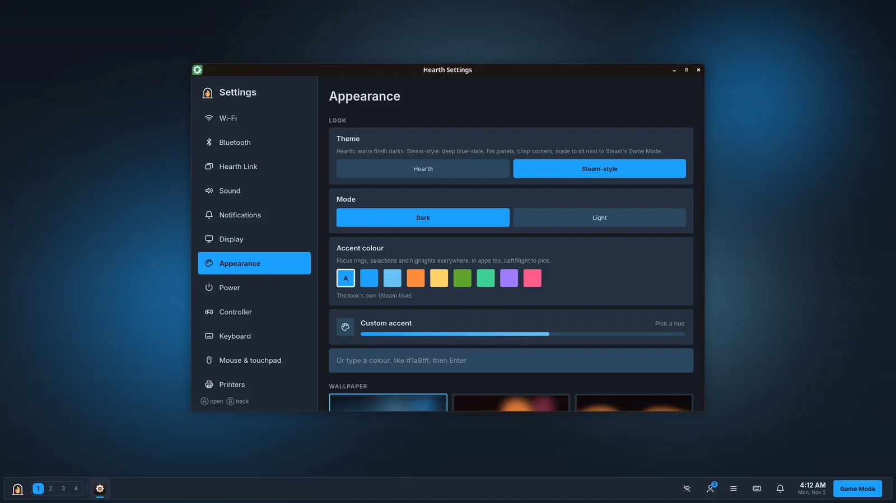
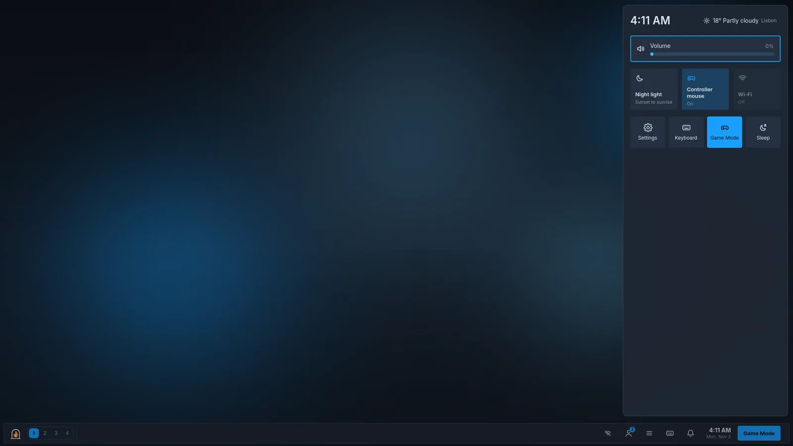

<p align="center">
  
</p>

<h1 align="center">Hearth OS</h1>

<p align="center">
  <b>Steam Game Mode on the couch. Mantel on the desk.</b><br>
  A free, Debian-based OS for gaming PCs and handhelds.
</p>

<p align="center">
  <a href="https://hearthos.fun"><b>Website</b></a> ·
  <a href="https://hearthos.fun/#download"><b>Download</b></a> ·
  <a href="https://hearthos.fun/docs/"><b>Docs</b></a> ·
  <a href="https://hearthos.fun/docs/releases.html"><b>Release notes</b></a> ·
  <a href="docs/ROADMAP.md"><b>Roadmap</b></a> ·
  <a href="https://github.com/Dragongamer9/hearth-os/issues"><b>Report a problem</b></a>
</p>

<p align="center">
  <a href="https://github.com/Dragongamer9/hearth-os/releases/latest"></a>
  
  <a href="LICENSE"></a>
</p>

<p align="center">
  
</p>

Hearth OS starts straight into **Steam Game Mode**, the same full-screen gamepad interface SteamOS uses. Your games
from other stores show up in Steam's library too, and **Mantel**, Hearth's own desktop, is one press away.

Prefer Hearth's own screens? **Hearth Game Mode** is a choice in Settings › Gaming › Game Mode (from 1.10); Steam Game
Mode stays the default. See [docs/HEARTH-GAME-MODE.md](docs/HEARTH-GAME-MODE.md).

## What's in 1.0

- **Steam Game Mode** is the Game Mode. Turn the device on and you're in Steam, ready for the controller. If Steam
  can't start, Mantel opens with the reason and a button to try again.
- **Hearth Sync**, a small Decky plugin, puts your games from outside Steam into Steam's library with their covers and
  a collection per store, and keeps them in sync: Epic and GOG through Heroic, Minigalaxy (preinstalled), Epic's Linux
  launcher, Battle.net, Xbox Cloud Gaming, emulators, recomps, Beacon and games you add yourself.
- **Mantel**, the desktop (Hearth Classic: labwc + Quickshell), works with a controller or a mouse and keyboard. It
  has a Steam-style look by default, new wallpapers, accent colours, light and dark modes, the Hearth menu on the
  Guide button, an on-screen keyboard, Hearth Link and Hearth Storage. Bazaar is the app store (Flathub).
- **Debian 13 underneath**, image-based (bootc): one image for AMD, Intel and Nvidia. It's a normal writable system
  (apt and .deb files work) and can be locked in Settings.
- **Updates that can't strand you.** See below.

<p align="center">
  
</p>

## Install

Download both from [hearthos.fun](https://hearthos.fun/#download) and write them to USB sticks (for example with
Hearth Disks, balenaEtcher or Ventoy):

| | | |
|---|---|---|
| **Hearth OS USB** (offline installer, Debian) | about 4.3 GB | [hearth-os-peppermint.iso](https://pub-f59beb6fa21c421ca4435ee7f42b3de4.r2.dev/hearth-os-peppermint.iso) · [SHA-256](https://pub-f59beb6fa21c421ca4435ee7f42b3de4.r2.dev/hearth-os-peppermint.iso.sha256) |
| **Recovery USB** (reinstall keeping your files, copy files off, start the previous version) | about 5 GB | [hearth-recovery.iso](https://pub-f59beb6fa21c421ca4435ee7f42b3de4.r2.dev/hearth-recovery.iso) · [SHA-256](https://pub-f59beb6fa21c421ca4435ee7f42b3de4.r2.dev/hearth-recovery.iso.sha256) |

The installer needs no internet. Step by step: [hearthos.fun/docs/install.html](https://hearthos.fun/docs/install.html).

## Updates and going back

- The whole system updates as one piece in the background. Check for updates from Steam's own settings or from
  Settings › System › Updates; the device never restarts by itself.
- The previous version always stays in the boot menu. Pick it to go back, or use Settings › System › Updates.
- A version that fails to start twice in a row goes back by itself. Holding **Volume Down** while it starts opens
  Hearth Recovery, so a handheld can be rescued without a keyboard.
- If nothing starts, the Recovery USB can start the previous version or reinstall while keeping your files.

More: [hearthos.fun/docs/updates.html](https://hearthos.fun/docs/updates.html).

## Version numbers

From 1.0 on, versions are **MAJOR.MINOR** with a release date: Hearth OS 1.0, then 1.1, 1.2 … 1.10, and 2.0 for the
next big change. Build files and git tags use three parts (`1.0.0`). Details: [docs/UPDATES.md](docs/UPDATES.md).
What's planned next (1.1: a new Steam-style installer, startup animations, boot splash presets and a GRUB theme) is
in the [roadmap](docs/ROADMAP.md).

## Ember (Windows 11)

Ember is Hearth on Windows 11: it replaces Explorer, or runs on top of it, and keeps Hearth's own Game Mode. Get it
from the [latest release](https://github.com/Dragongamer9/hearth-os/releases/latest/download/Nimbus-win-x64.zip) or
in PowerShell:

```powershell
irm https://raw.githubusercontent.com/Dragongamer9/hearth-os/main/tools/install-nimbus.ps1 | iex
```

More: [docs/EMBER.md](docs/EMBER.md).

## Where things are

```
os-bases/peppermint/     The Debian image (bootc): Containerfile, build.sh and its own system files
os/                      Shared system files (os/system_files), the installer USB (os/live), Recovery (os/recovery)
hosts/linux/             The Linux session and Mantel (desktop/shell: Quickshell QML; desktop/labwc; desktop/theme)
hosts/decky-hearth-sync/ Hearth Sync, the Decky plugin for Steam Game Mode
hosts/hearth-core/       Rust: library, stores, settings, updates, Hearth Link and the rest of Hearth's core
hosts/hearth-rs/         Rust: the Hearth app (Tauri); Hearth Game Mode (a choice next to Steam Game Mode)
hosts/hearth-*/          Hearth's apps (Terminal, Disks, Photos, Text, Tools …)
hosts/windows/           Ember: .NET 8 + WebView2
ui/                      The web interface shared by Ember and Hearth's own Game Mode
site/                    hearthos.fun (site/docs is built by tools/build-docs.py)
docs/                    Design notes and guides; docs/archive holds docs of archived parts
archive/                 Archived code, kept so it can come back (see below)
tools/                   Build, check and release helpers
```

Every push is built and tested on GitHub Actions. A version change on `main` is a release. The project used to be
called Nimbus; internal names (`~/.config/nimbus`, release file names, the `hearth-peppermint` image) stay as they
are so existing installs keep updating.

## Archived

Kept in the repository, but not built or shipped: the Anatase (Fedora), Ubuntu, CachyOS and Bazzite editions, Hearth Plasma / GNOME /
COSMIC / Deepin, multi-seat and Couch Co-op, the old Hearth Decky plugin, the small online installer, Hearth's app
store and Hearth for Android. What each was and where its code lives: [docs/ARCHIVED.md](docs/ARCHIVED.md).

## License

Hearth OS (including Ember, Mantel and Hearth's apps) is free software under the **GNU General Public License v3.0
or later** ([LICENSE](LICENSE)). Parts from other projects keep their own licenses (Debian, gamescope, Decky Loader,
Handheld Daemon and the libraries the apps use).

Hearth OS is an independent project, not affiliated with Valve, Epic Games, GOG, Microsoft or Debian. Steam, Epic
Games, GOG and Xbox are trademarks of their owners.
